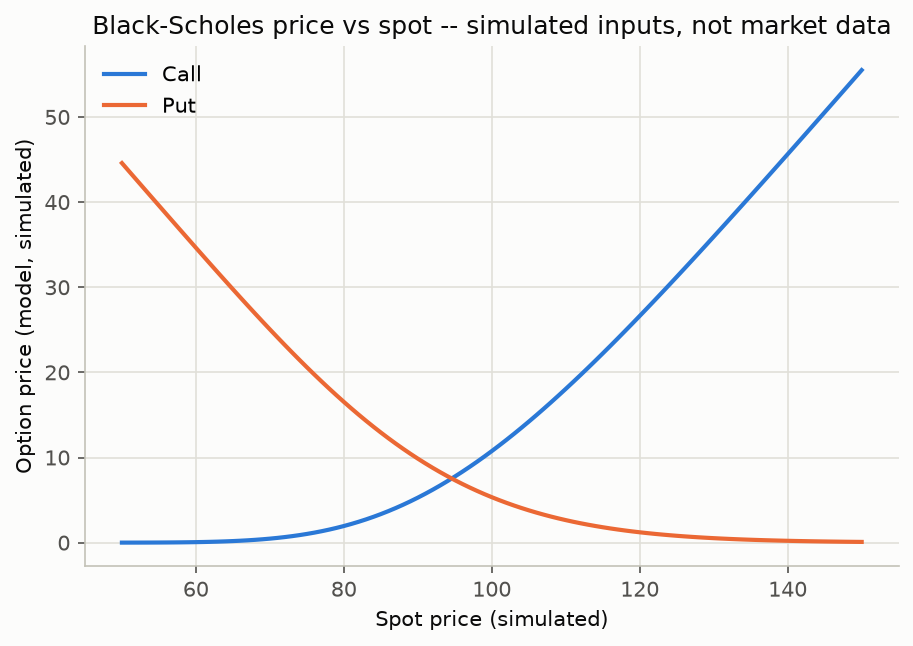
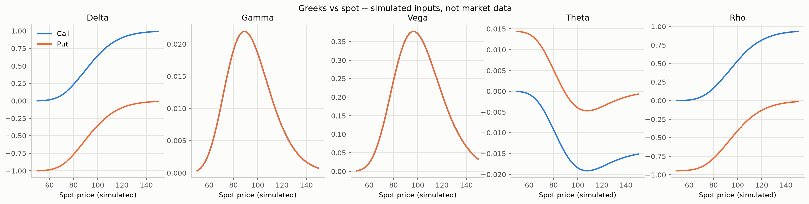
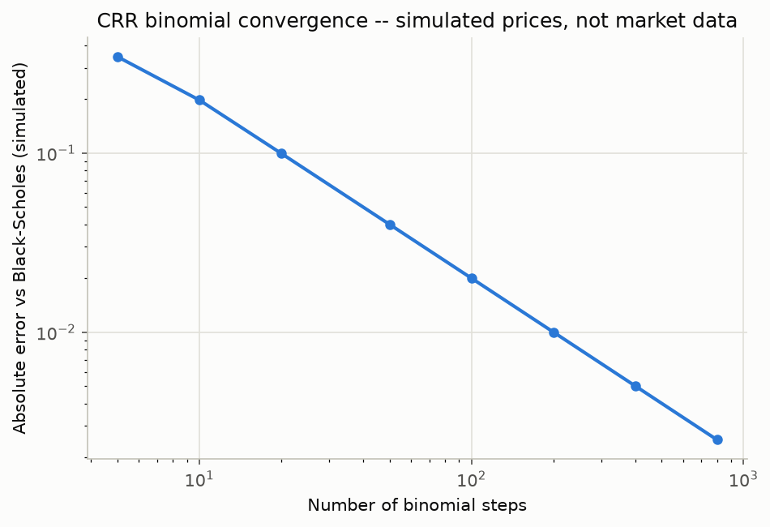
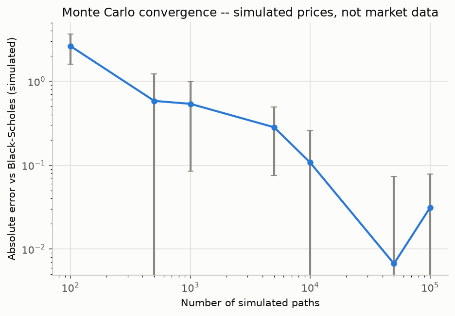
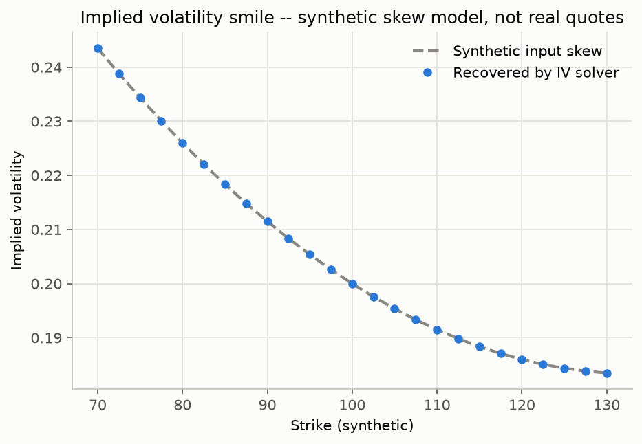
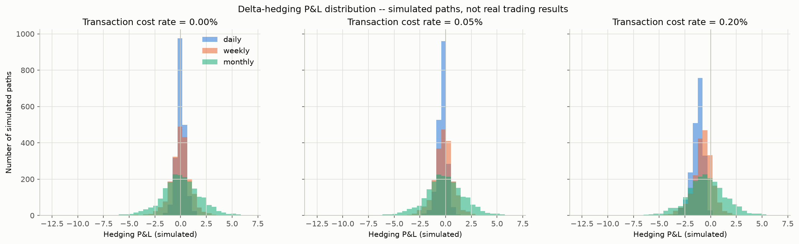

# Options Pricing and Risk Engine

A small Python toolkit for pricing European options, computing Greeks,
solving for implied volatility, comparing numerical pricing methods, and
simulating delta hedging.

**Everything in this project is simulated or synthetic.** All prices,
volatility smiles, and hedging paths are generated by code in this
repository with fixed assumptions and a fixed random seed. None of it
is real market data, and nothing in this project is a claim about
trading performance.

## Objective

This project was built to practice implementing core quantitative
finance models from scratch and to understand them well enough to
explain every number that comes out of them:

- Price European calls and puts with the Black-Scholes-Merton formula.
- Compute the standard Greeks in their usual trading conventions.
- Solve for implied volatility given a price.
- Compare a closed-form price against two numerical methods (a
  binomial tree and Monte Carlo simulation) and show how they converge.
- Simulate what happens to a hedged short option position as
  rebalancing frequency and transaction costs change.

## Setup

Requires Python 3.12.

```bash
python -m venv .venv
source .venv/bin/activate   # on Windows: .venv\Scripts\activate
pip install -r requirements.txt
```

## Usage

Run the full pipeline (prices a base scenario, runs the convergence
studies, builds the IV smile, runs the hedging simulation, and writes
charts + a report to `outputs/`):

```bash
python main.py
```

Run the tests:

```bash
pytest
```

Everything the pipeline produces is written to `outputs/` (git-ignored):
six PNG charts and `report.md`, a Markdown summary built only from
numbers that actually ran in that session.

## Project structure

```
src/options_engine/
    config.py        central assumptions and parameters
    black_scholes.py European option pricing (BSM)
    greeks.py         delta, gamma, vega, theta, rho
    implied_vol.py    Newton-Raphson + bisection IV solver
    binomial.py       Cox-Ross-Rubinstein tree pricer
    monte_carlo.py    Monte Carlo pricer under GBM
    hedging.py        delta-hedging simulation with transaction costs
    plots.py          chart-making functions
    report.py         builds the Markdown report
tests/                one test file per module
main.py                runs the full pipeline
outputs/               charts + report (generated, git-ignored)
```

## Formulas

**Black-Scholes-Merton (with continuous dividend yield q):**

```
d1 = [ln(S/K) + (r - q + 0.5*sigma^2) * T] / (sigma * sqrt(T))
d2 = d1 - sigma * sqrt(T)

Call = S * e^(-qT) * N(d1) - K * e^(-rT) * N(d2)
Put  = K * e^(-rT) * N(-d2) - S * e^(-qT) * N(-d1)
```

**Put-call parity:** `Call - Put = S*e^(-qT) - K*e^(-rT)`

**Greeks and their units** (see `greeks.py` for the full derivations):

- Delta: dPrice/dSpot, unitless.
- Gamma: d(delta)/dSpot, same for calls and puts.
- Vega: dPrice/dVolatility, reported **per 1 volatility point** (per
  0.01 change in sigma).
- Theta: dPrice/dTime, reported **per calendar day** (the per-year
  calculus derivative divided by 365, sign flipped so it represents
  decay as time passes).
- Rho: dPrice/dRate, reported **per 1 percentage point** change in the
  risk-free rate.

**Implied volatility:** solved by inverting the Black-Scholes formula
with Newton-Raphson (using vega as the derivative), falling back to
bisection if Newton-Raphson doesn't converge or leaves the search
bounds. Prices outside the no-arbitrage bounds for a European option
are rejected before any solving is attempted.

**CRR binomial tree:**

```
u = e^(sigma * sqrt(dt)),  d = 1/u
p = (e^((r-q)*dt) - d) / (u - d)
```

Terminal payoffs are weighted by their risk-neutral binomial
probabilities and discounted back to today — since the option is
European, there's no need to check for early exercise at each node.

**Monte Carlo:** terminal stock prices are simulated directly under the
risk-neutral measure,

```
S_T = S0 * exp[(r - q - 0.5*sigma^2)*T + sigma*sqrt(T)*Z],  Z ~ N(0,1)
```

and the price is the discounted average payoff, reported with its
standard error.

**Delta hedging:** a short call is hedged by holding `delta` shares of
the underlying, rebalanced at a fixed frequency. Each trade incurs a
proportional transaction cost (`cost_rate * |shares traded| * price`).
The simulation is self-financing: the cash account earns the
risk-free rate between rebalances, and the final P&L is what's left in
cash (plus the hedge being unwound) after the option's payoff is
settled at maturity.

## Assumptions

- **European exercise only** — no early exercise, so these models do
  not apply directly to American-style options.
- **Constant volatility and constant risk-free rate** over the life of
  the option (no stochastic volatility, no term structure).
- **Geometric Brownian motion, no jumps** — the underlying's returns
  are lognormally distributed with no jumps or fat tails beyond what
  a lognormal distribution produces.
- **Frictionless markets except for the explicit cost model** in the
  hedging simulation — no bid/ask spread, slippage, or market impact,
  only a proportional transaction cost rate.
- **Risk-free rate** is a single constant set in `config.py`:
  `RISK_FREE_RATE = 0.0557` (5.57%), based on the RBI 91-day T-bill
  cut-off yield of 5.5747% from the 7 October 2026 auction, rounded.
  This is a modeling assumption fixed once at the start of the
  project, not a live or continuously updated rate. Every other
  adjustable parameter (default spot/strike/maturity/volatility, grid
  sizes, number of simulated paths, the random seed, transaction cost
  rates, the synthetic skew shape) is also centralized in
  `config.py`.

## Limitations

- No American-style early exercise, so this cannot price most
  exchange-traded single-stock options accurately.
- No stochastic volatility or local volatility — the IV "smile" here is
  manufactured from a toy skew formula precisely so it *can* be
  recovered cleanly; it is not fit to anything observed.
- No dividends beyond a constant continuous yield (no discrete cash
  dividends).
- The hedging simulation hedges with the same volatility used to
  generate the paths, so it does not capture the real-world problem of
  not knowing the "true" volatility in advance.
- Transaction costs are modeled as a simple proportional rate; real
  trading costs (bid/ask spread, market impact, financing costs) are
  more complex.

## Future improvements

- American option pricing (e.g. via the binomial tree with early
  exercise checks at each node).
- Local or stochastic volatility models (e.g. Heston) for a more
  realistic smile.
- Greeks for the binomial and Monte Carlo pricers, not just
  closed-form Black-Scholes.
- Variance reduction techniques for Monte Carlo (antithetic variates,
  control variates) to tighten the standard error for a given number
  of paths.

## Results

All numbers below are copied directly from `outputs/report.md`, produced
by a run of `python main.py` with the base scenario (Spot = 100,
Strike = 100, Maturity = 1 yr, Rate = 5.57%, Volatility = 20%, Dividend
yield = 0%) and `RANDOM_SEED = 42`. Every figure is a simulated or
synthetic model output, not a market price.

**Base scenario (simulated Black-Scholes price and Greeks):**

| Quantity | Call | Put |
|---|---|---|
| Black-Scholes price | 10.7562 | 5.3385 |
| Delta | 0.6475 | -0.3525 |
| Gamma | 0.0186 | 0.0186 |
| Vega (per vol pt) | 0.3714 | 0.3714 |
| Theta (per day) | -0.0184 | -0.0040 |
| Rho (per 1% rate) | 0.5399 | -0.4059 |

- Put-call parity check (call − put − forward value): **-7.11e-15**
  (simulated; effectively zero, i.e. machine-precision noise).
- Implied volatility recovery check (synthetic): priced a call at
  input volatility 20.00%, solver recovered **0.200000** in 1 Newton
  iteration, absolute error **0.00e+00**.

**CRR binomial convergence to Black-Scholes (simulated prices):**

| Steps | Binomial price | Abs. error vs BS |
|---|---|---|
| 5 | 11.101712 | 3.46e-01 |
| 10 | 10.558280 | 1.98e-01 |
| 20 | 10.656490 | 9.97e-02 |
| 50 | 10.716139 | 4.00e-02 |
| 100 | 10.736132 | 2.00e-02 |
| 200 | 10.746149 | 1.00e-02 |
| 400 | 10.751161 | 5.02e-03 |
| 800 | 10.753669 | 2.51e-03 |

**Monte Carlo convergence to Black-Scholes (simulated prices, seed 42):**

| Paths | MC price | Std. error | Abs. error vs BS |
|---|---|---|---|
| 100 | 8.127676 | 1.030795 | 2.63e+00 |
| 500 | 10.172669 | 0.643291 | 5.84e-01 |
| 1,000 | 10.217462 | 0.453598 | 5.39e-01 |
| 5,000 | 10.473137 | 0.208218 | 2.83e-01 |
| 10,000 | 10.648787 | 0.149338 | 1.07e-01 |
| 50,000 | 10.762866 | 0.066895 | 6.69e-03 |
| 100,000 | 10.725003 | 0.047301 | 3.12e-02 |

- Implied volatility smile (synthetic skew model): max absolute error
  between the input skew and the volatility recovered by the solver
  was **2.40e-10**.

**Delta-hedging simulation (simulated paths, 2,000 paths per setting,
252 steps over 1.0 year, seed 42):**

| Rebalancing | Cost rate | Mean P&L | Std dev P&L |
|---|---|---|---|
| daily | 0.00% | -0.0007 | 0.4400 |
| daily | 0.05% | -0.3181 | 0.4523 |
| daily | 0.20% | -1.2703 | 0.5832 |
| weekly | 0.00% | -0.0313 | 0.9663 |
| weekly | 0.05% | -0.2121 | 0.9739 |
| weekly | 0.20% | -0.7547 | 1.0089 |
| monthly | 0.00% | 0.0190 | 1.9305 |
| monthly | 0.05% | -0.1003 | 1.9356 |
| monthly | 0.20% | -0.4581 | 1.9531 |

**Observations (all from the simulated numbers above):**

1. The put-call parity check came out at -7.11e-15, confirming the
   call and put pricing formulas are internally consistent to
   floating-point precision on this simulated scenario.
2. Binomial convergence is monotonic and roughly halves with each
   doubling of steps (0.346 → 0.198 → 0.0997 → 0.0400 → ... → 0.00251
   from 5 to 800 steps), consistent with the O(1/N) convergence rate
   expected of a CRR tree.
3. Monte Carlo error is noisier than the binomial tree's but still
   shrinks as paths grow, landing at an absolute error of 3.12e-02
   against Black-Scholes at 100,000 paths — within roughly one
   reported standard error (0.047) of the closed-form price, so the
   remaining gap is explained by sampling noise rather than bias.
4. In the zero-cost hedging rows, the standard deviation of P&L scales
   roughly with the square root of the number of rebalances, as
   expected for discretization error that accumulates like a random
   walk: going from 12 rebalances/year (monthly, std 1.9305) to 50.4
   (weekly, std 0.9663) to 252 (daily, std 0.4400), the std ratios
   (1.998 monthly/weekly, 2.196 weekly/daily) track the
   sqrt(n_fine/n_coarse) ratios (2.049 and 2.236) to within about 4%.
5. Adding transaction costs pushes mean P&L negative and increases
   its spread at every rebalancing frequency (e.g. daily mean P&L
   goes from -0.0007 at 0% cost to -1.2703 at 0.20% cost), and the
   effect is largest for daily rebalancing because it trades most
   often — showing the expected trade-off between hedging accuracy
   and cost drag.

## Screenshots

Charts below are from the same run referenced above
(`docs/images/`), generated by `python main.py`. All are simulated or
synthetic outputs.

**Option price vs spot (simulated Black-Scholes prices):**



**Greeks vs spot (simulated Black-Scholes Greeks):**



**CRR binomial convergence to Black-Scholes (simulated prices):**



**Monte Carlo convergence to Black-Scholes (simulated prices):**



**Implied volatility smile (synthetic skew model, not real quotes):**



**Delta-hedging P&L distributions (simulated paths, not real trading
results):**


